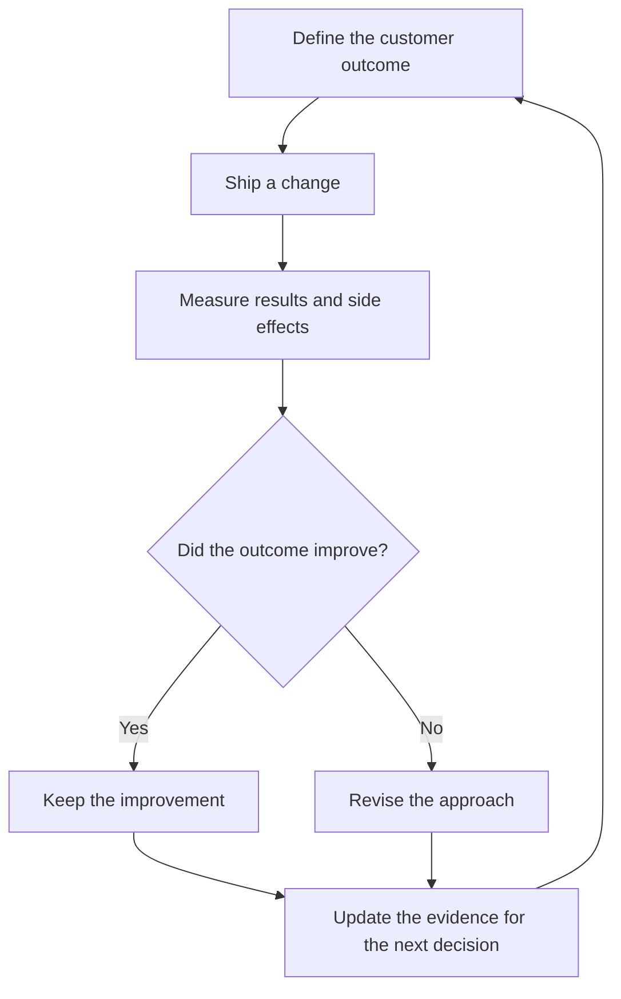
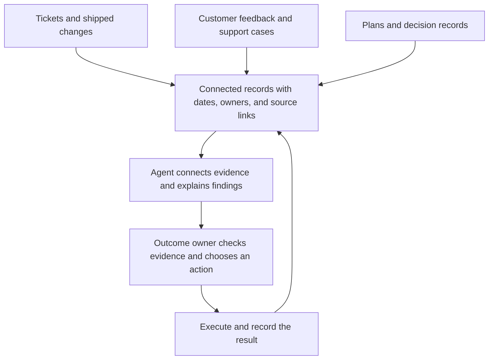
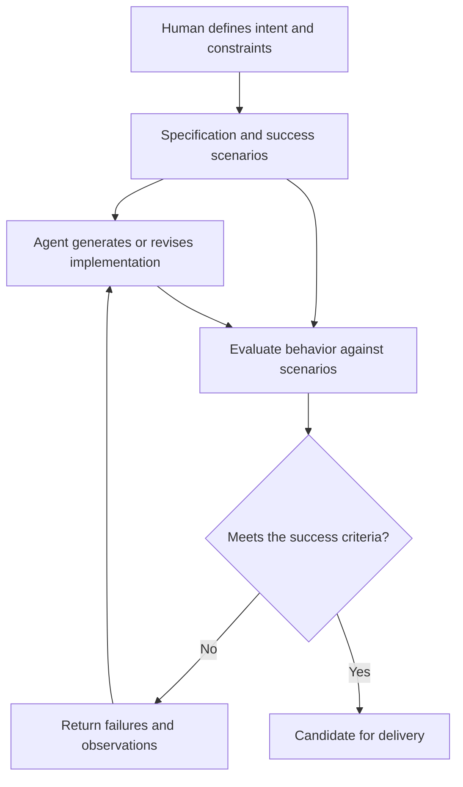

> **Based on:** [How To Build A Company With AI From The Ground Up](https://www.youtube.com/watch?v=EN7frwQIbKc), presented by YC Partner Diana Hu and published by Y Combinator on April 24, 2026.
>
> **Central idea:** Design the company around AI’s capabilities, including how information moves, how work is evaluated, and who owns the result.

Giving everyone an AI assistant leaves an important question unanswered: what should the organization itself do differently?

Hu’s talk addresses that question through company design. She proposes an operating model built around feedback loops, accessible organizational knowledge, agent-driven implementation, and explicit human ownership. This article develops that model through explanations and hypothetical examples; those examples are applications of the argument, rather than case studies reported in the video. The StrongDM and Block sections also draw on the original accounts behind examples she mentions.

## 1. AI as an operating system: what the metaphor means

Hu frames AI as a foundation for company operations. The opportunity is to give small teams capabilities that previously demanded much larger groups. Her starting point is to make important processes continuously capture results and adjust their next actions. [Watch the opening argument.](https://www.youtube.com/watch?v=EN7frwQIbKc&t=58s)

Consider a hypothetical customer-support team. An assistant that drafts replies can save an individual time. But suppose the team keeps receiving questions about the same confusing setup step. Faster replies alone leave that problem intact.

A more useful organizational design would connect those conversations to product work. Someone could identify the repeated obstacle, link it to the relevant onboarding screen, propose a change, and check whether the same questions decline after release. An agent could help carry that information between systems while a person owns the decision and result.

The distinction matters because the unit of improvement becomes the entire process. A polished reply is useful; fewer customers getting stuck is a stronger outcome.

## 2. Close the loop between action and evidence

Hu contrasts open-loop execution with closed-loop operation: decisions lead to action, outcomes are observed, and that evidence changes what happens next. [Watch the feedback-loop discussion.](https://www.youtube.com/watch?v=EN7frwQIbKc&t=117s)

*The return path closes the loop: evidence from one release shapes the next decision. Stopping at “ship a change” leaves the outcome unknown.*

To make this concrete, imagine a startup trying to improve activation. It ships a new onboarding checklist. The release itself proves only that the team delivered something. It does not establish that customers reached their first useful result sooner.

A complete experiment would need four things:

1. **An objective:** Help new accounts complete their first successful import.
2. **An observation:** Track completion, time spent, abandonment, and relevant support requests.
3. **An interpretation:** Compare results with the intended improvement and inspect failures.
4. **A next action:** Keep, revise, or remove the checklist based on that evidence.

An agent might notice that imports succeed more often but now generate more duplicate records. That finding should change the next task. Optimizing only for completion would have hidden the trade-off.

This example also shows why a feedback loop needs a meaningful target. A team can improve a number while making the product worse. Before automating repeated decisions, it should specify what success means and which unwanted effects would invalidate the result.

## 3. Make company knowledge queryable

Hu argues that agents need access to the context employees use: engineering tickets, discussions, customer feedback, plans, and meeting records. Her sprint-planning example connects what shipped with whether it met customer needs. [Watch the organizational-context example.](https://www.youtube.com/watch?v=EN7frwQIbKc&t=180s)

Imagine asking an agent, “Why did the import redesign slip?” A ticket tracker might say that the work is blocked. The explanation could live elsewhere: a customer conversation changed the requirements, a design decision invalidated the original approach, and a dependency arrived late.

For that question to be answerable, storing more documents is only the beginning. The records need enough structure to distinguish an early proposal from an approved decision, connect related work, and identify the person responsible for resolving the blocker.

*This illustrates a flow of information, rather than a required architecture. The owner can trace a recommendation back to its sources, and the result becomes context for future work.*

A useful decision record could be very short:

| Field | Example |
| --- | --- |
| Decision | Support large imports through a background job |
| Reason | Target customers routinely exceed the current request timeout |
| Evidence | Linked support cases and observed import failures |
| Owner | Engineer responsible for import reliability |
| Review condition | Revisit after measuring completion and recovery rates |

This is an illustrative format, rather than a prescribed tool stack. Its purpose is to preserve the relationship between a choice, its evidence, and its consequences.

The practical test is whether a person or agent can explain an answer and point back to the records supporting it. A confident answer without traceable evidence is a poor basis for changing the roadmap.

## 4. Software factories shift attention toward specifications and evaluation

Hu introduces software factories as a model where people define desired behavior and agents implement against evaluations. [Watch the software-factory section.](https://www.youtube.com/watch?v=EN7frwQIbKc&t=300s)

The StrongDM AI team’s own account describes development driven by specifications and scenarios, with agents generating code, running harnesses, and iterating without human code review. It distinguishes ordinary test success from *satisfaction*: whether observed behavior across scenarios is likely to satisfy the user. Scenarios can act like held-out user stories, separate from the implementation. This is the team’s reported approach, rather than proof that every codebase is ready for the same workflow. [Read StrongDM’s original account.](https://factory.strongdm.ai/)

The important engineering question becomes: **How would we recognize a successful implementation without relying on how convincing its code looks?**

*Implementation and evaluation form the inner loop. The specification supplies the target; weak success criteria can produce a passing implementation that still disappoints users.*

Take a hypothetical invitation feature. “Users can invite teammates” leaves many decisions unspecified. Can invitations expire? What happens if the recipient already belongs to the workspace? Can an administrator revoke an invitation after it is sent? What should happen if two acceptance requests arrive together?

A useful specification makes those expectations explicit. An evaluation then exercises the behavior from the user’s perspective, including failed and repeated attempts. The implementation may change substantially while the required behavior stays stable.

That separation gives the human a demanding job: deciding what matters and creating evidence that the system actually does it. If an evaluation checks only whether an email was sent, the agent can pass while producing an invitation flow that nobody can successfully complete.

## 5. Replace information routing with clear responsibility

Hu connects this operating model to fewer coordination layers and three broad roles: builders, people accountable for outcomes, and founders who continue building and coaching. [Watch the organization-design section.](https://www.youtube.com/watch?v=EN7frwQIbKc&t=432s)

The related essay by Jack Dorsey and Roelof Botha describes Block’s proposed structure more specifically. Individual contributors build and operate systems; directly responsible individuals own cross-functional outcomes; player-coaches combine building with developing people. A continuously updated model of company activity would take over much of the information relay previously performed by management. The authors explicitly describe Block as being early in a difficult transition. [Read “From Hierarchy to Intelligence.”](https://sequoiacap.com/article/from-hierarchy-to-intelligence)

For a practical example, imagine an owner responsible for reducing failed imports. An agent could collect the relevant incidents, summarize recurring causes, and identify unfinished fixes. That removes some preparation work, but it does not settle the priority decision.

The owner still needs to decide whether to delay a new feature, ask another team for help, or accept a temporary workaround. Those choices involve competing commitments and consequences for customers.

Clear ownership therefore becomes more important as automated execution expands. If several agents generate proposals and several people can approve them, who answers when the outcome gets worse? A useful organizational design makes that answer obvious before increasing the volume of work.

## 6. Evaluate compute spending against useful outcomes

Hu urges founders to build firsthand conviction with agents, reconsider compute spending relative to staffing, and exploit the freedom startups have to design new processes. Her “1,000x engineer” framing is an ambitious claim, rather than a demonstrated multiplier every team should expect. [Watch the closing discussion.](https://www.youtube.com/watch?v=EN7frwQIbKc&t=552s)

A practical interpretation is to compare complete workflows. Suppose a recurring analysis takes a person several hours. An agent-assisted version costs money to run, requires preparation, and still needs review. The relevant comparison includes all of those inputs, along with whether the result arrives sooner and is reliable enough to use.

High token consumption alone says little. An expensive run that reveals a costly product defect may be valuable. Repeated runs that produce interchangeable reports may add little.

Useful questions include: How much time did the owner actually recover? How much rework followed? Did the output change a decision? Could the same process run again with less intervention? These are suggested evaluation questions for applying the talk’s argument, rather than metrics prescribed in the video.

## 7. A practical starting point: one complete workflow

The following is an application of the ideas above. A small team could begin with a single recurring problem, such as turning onboarding failures into product improvements.

First, name an owner and define the outcome. “Improve onboarding” is too broad; “reduce the share of new accounts unable to complete an import” is easier to evaluate.

Next, gather the relevant evidence: failed-import events, support cases, the current onboarding flow, and recent changes. Ask an agent to explain the most common failure patterns and link each claim to its source. The owner can then check whether the evidence supports the proposed intervention.

After choosing a change, specify the behavior it should produce and the cases it must handle. Use an agent for implementation where appropriate, then evaluate the result against those expectations.

Finally, return to customer outcomes after release. Did failures decline? Did a new problem appear? What should change in the next iteration?

Completing that cycle exposes the real obstacles: missing records, ambiguous objectives, weak evaluations, or unclear authority. Fixing those obstacles gives the team a concrete operating practice it can extend to another workflow.

Hu’s proposal is demanding because it reaches beyond tool adoption. It asks founders to make work understandable, success observable, and responsibility explicit. The strongest place to begin is a process where those changes can produce a result customers can feel.

## Sources and viewing guide

- [Original video — Y Combinator](https://www.youtube.com/watch?v=EN7frwQIbKc): operating-system framing at 0:58, feedback loops at 1:57, queryable knowledge at 3:00, software factories at 5:00, organizational change at 7:12, and the startup opportunity at 9:12.
- [Available transcript](https://www.usetranscribe.io/yt/EN7frwQIbKc/build-ai-company), used to check the talk’s sequence and examples.
- [StrongDM: Software Factories and the Agentic Moment](https://factory.strongdm.ai/), the original account expanding the software-factory example.
- [Dorsey and Botha: From Hierarchy to Intelligence](https://sequoiacap.com/article/from-hierarchy-to-intelligence), the original essay expanding the organization-design example.
