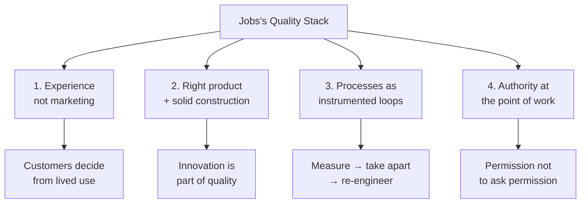
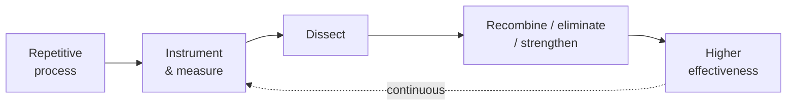
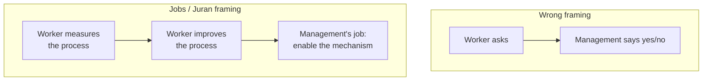
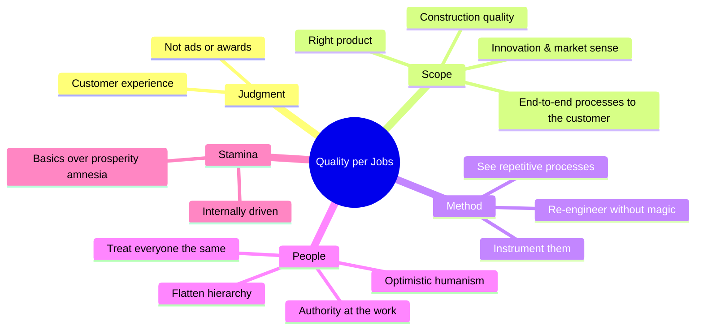

> **Based on**: [Steve Jobs on Joseph Juran and Quality](https://www.youtube.com/watch?v=XbkMcvnNq3g) — interview for *An Immigrant’s Gift* (Dec 19, 1991, Redwood City; Jobs as President of NeXT Computer). Full transcript also archived in the [NSU Juran Collection](https://nsuworks.nova.edu/juran-transcripts/46).
>
> **Core Insight**: Quality is not a slogan, an award, or a pep rally. It is the scientific re-engineering of repetitive processes — judged only by customer experience with the *right* product — and it only works when authority to improve is given to the people doing the work.

In December 1991, while filming a documentary on quality pioneer Dr. Joseph M. Juran, interviewer Jack Schatz sat down with Steve Jobs at NeXT. Jobs had already left Apple, built NeXT, and was still years from returning to reinvent consumer computing. The conversation is not a product pitch. It is Jobs explaining what “quality” meant when stripped of marketing — and why Juran’s scientific, people-respecting approach resonated with engineers more than the “second coming” rhetoric of the era’s quality boom.

What follows is a full summarization of the **concept of quality** Jobs articulates, and the **stories and portraits** he uses to make it stick.

## 1.0 Context: Why NeXT Sought Juran

NeXT set out to understand “all of the ballyhoo about quality.” They met many people. Most treated quality as something almost religious. Juran did not.

**What Jobs valued in Juran**:

- A **down-to-earth**, scientific stance — not quality as “the second coming”
- Language that **resonated with engineers and executives** alike
- Repeated visits to NeXT, “always wearing his characteristic bow tie”

Jobs is explicit: he never met Juran during the Apple years. The contact — and the operational shift — happened at NeXT.

## 2.0 The Concept of Quality: What Jobs Actually Means

### 2.1 Quality as re-engineering repetitive processes

The single most concrete definition Jobs gives is operational, not aesthetic:

1. Treat **everything** as a repetitive process
2. **Instrument** it — measure how it actually runs
3. Take it apart and put it back together so it is **dramatically more effective**
4. Combine some steps, eliminate others, strengthen what remains

> No magic. No pep rallies. Look things directly in the eye.

In Jobs’s reading, most of “quality stuff” is this: **process re-engineering with measurement**, applied honestly.

### 2.2 Quality is decided by experience, not by awards

Jobs’s sharpest cultural critique targets American companies that **advertise** quality while Japanese companies largely do not — yet street reputation for quality still favors Japanese products.

**Why?**

- Customers do **not** form quality opinions from marketing
- They do **not** form them from who won the Deming Award or the Baldrige Award
- They form them from **their own experience** with products and services

Implication: you can spend enormous money on quality programs, win every award, and still lose the customer’s mind if the product does not live up to it.

**Where to start**: products and services — not the marketing department.

### 2.3 Quality includes having the *right* product

Jobs refuses a narrow “build it well” definition. Quality is also:

- Knowing where the market is going
- Shipping the **most innovative** products
- Construction quality when you have the product

Innovation and fitness-to-market are as much “quality” as fit-and-finish.

### 2.4 Quality must reach the customer, not stop at the factory

Leaders who take quality seriously, Jobs says, push it **beyond manufacturing** into sales, marketing, and every touchpoint back from the customer through delivery — so the company can:

- Understand customer needs fastest
- Ship the most innovative products
- Run **super-efficient processes** end to end

Quality is a system that touches the customer, not a manufacturing department badge.

### 2.5 The scientific shift vs. “because we’ve always done it this way”

Asked what NeXT does differently after Juran (versus Apple-era practice), Jobs describes a cultural fork:

| Traditional company | Quality-informed company |
| --- | --- |
| “Why is it done this way?” → “That’s how we do it here / how it’s always been done.” | Processes have a **theory**, a **description**, and an open invitation to **question** them |
| People as pawns following tradition | People as smart agents who will improve processes if given a mechanism |

Jobs calls that single shift **everything**. Inside it sits what he names **optimistic humanism**: assume people are intelligent; give them a way to change the work; they will.

### 2.6 The permission that matters: permission not to ask permission

When the interviewer frames “optimistic humanism” as what management says *yes* to, Jobs flips the premise:

> The question itself capsulizes what’s wrong.

Under the quality philosophy he absorbed from Juran:

- People should **not** need management permission to improve work that needs improving
- Authority should be **vested in the people doing the work**
- Teach them to measure, understand, and improve their own processes
- The organizational consequence is a **flattening** of hierarchy and a redistribution of decision rights to those closest to the process

The permission quality gives is the permission **not to ask permission**.

## 3.0 The National Story: America Forgot the Basics

Jobs situates Juran’s relevance in a larger American crisis of the early 1990s:

- Long prosperity → too many things taken for granted
- Forgotten how much work it took to sustain education systems and great industry
- Now forced to **relearn the basics**

Japan’s advantage, in his telling, is not trickery and not intellectual superiority. America is being **out-planned, out-strategized, and out-manufactured**. Nothing that cannot be fixed — but it will not be fixed “up here” (in rhetoric or prestige). It will be fixed by returning to fundamentals. Juran, Jobs says, stands on that basic heart of the matter.

This is Jobs’s civic story: quality as national relearning, not corporate fashion.

## 4.0 Stories and Portraits Jobs Tells

Jobs does not pack the interview with product war stories. The memorable “stories” are **character sketches and moral scenes** — how great people behave, what sustained Juran, and what quality looks like when you watch customers instead of ads.

### 4.1 The hallmarks of great people: treat everyone the same

Jobs says the few “great people” he has met share one trait:

Whether janitor or company president, President of the United States or someone in a rural slum — **they treat them exactly the same**.

- Same look in the eyes
- Direct answer to the best of their ability
- Every question treated as the most important question that could have been asked at that moment

That, he says, was true of Juran: caring, straightforward, and optimistically willing to answer even “foolish” questions in order to transmit what he had learned.

**Story function**: quality culture is inseparable from how leaders regard ordinary people. Hierarchy of status collapses; hierarchy of attention does not — every person gets full seriousness.

### 4.2 The Japanese marketing paradox

Jobs’s street-test vignette:

1. American firms plaster “quality” across ads and internal literature
2. Japanese firms largely do **not** market quality that way
3. Ask people on the street whose products have the best quality reputation → they say Japanese

**Moral of the story**: reputation is downstream of lived product experience. Marketing quality without product quality is theater; skipping the theater while building the product still wins the street.

### 4.3 Awards that do not survive contact with the product

He pairs Deming and Baldrige awards with marketing as failed shortcuts to reputation. You can win every award and still lose the customer’s lasting opinion if the product fails them.

**Story function**: institutional trophies are not customer memory.

### 4.4 Juran’s heart, not his pocketbook

Asked for fondest memories of Juran for when only tapes and books remain, Jobs tells a travel-and-teaching story:

- At advanced age, mind “as alive as anyone I know”
- Energy to fly cross-country repeatedly to NeXT
- Draining days spent transmitting a lifetime of learning
- Motive is not money — “his heart is propelling him”
- Goal: teach the next generation before he can no longer do it
- Gain for himself: only that his ideas live on; he wants NeXT to be the kind of company he hopes to see more of

**Story function**: quality teaching as legacy work. The guru’s authority comes from devotion to transmission, not from consulting fees.

### 4.5 The wicked humor (without a punchline)

In private, Jobs found Juran warmer and funnier than the public seminar persona — “a pretty wicked sense of humor.” He imagines Juran was “a pretty wild character” when young. Asked for a specific joke, Jobs admits his memory for anecdotes is poor; he only remembers laughing a lot.

**Story function**: the public quality sage and the private human are not the same person; warmth coexists with rigor.

### 4.6 One subject, decades, and unseen sacrifice

Jobs never visited Juran’s home or met his wife — and he notes you learn a lot that way. Still, he offers a life-pattern story common to people who make deep contributions:

- Found a **great subject** early
- Pursued it for decades
- Contribution that outlasts physical years
- Below the surface: **sacrifices** — family, other lives they might have lived
- Jobs does not claim to know Juran’s specific sacrifices; he says you can **sense they are there**

**Story function**: seriousness about quality (or any great subject) has a human cost most audiences never see.

### 4.7 Internally driven through decades of non-listening America

Juran’s early impact in Japan (early 1950s) long preceded American recognition (Jobs places the lag at 30–40 years). What sustained him when audiences would not listen?

Jobs’s answer is a psychological story of sustained contributors:

1. Criticism is hard → you learn to listen to your **own drummer**
2. That isolation also mutes **praise** when it finally arrives
3. Praise and criticism both matter less → you become **internally driven**
4. You feel the **bedrock truth** of the pursuit; that keeps you going

On Japan specifically, Jobs imagines Juran’s satisfaction did not end in the 1950s: he helped nurture a culture and, decade by decade, sees ideas blossom — “every branch and leaf of a fairly large tree.” Late-career work, in Jobs’s reading, is injecting the same ingredient into the future culture of **American** industry as it rebuilds — so that in his last breath, Juran can know recognition will continue in decades to come.

**Story function**: quality philosophy that lasts is not fad-responsive; it is truth-responsive and internally fueled.

### 4.8 Deming: the story Jobs refuses to tell

Pressed to compare Juran and Deming, Jobs declines entirely: he never met Deming and never read his books. Ignorance stated plainly — no false synthesis.

## 5.0 Distilled Framework

If you compress the interview into a usable model:

| Theme | Jobs’s claim |
| --- | --- |
| Definition | Re-engineer repetitive, measured processes for effectiveness |
| Verdict | Only customer experience with the real product/service counts |
| Breadth | Right product + innovation + build quality + customer-connected operations |
| Culture | Question “always done this way”; vest improvement authority in workers |
| Leadership character | Great people give every person the same full attention |
| National allegory | Prosperity made America forget basics; Juran points back to them |
| Sustained contribution | Internal drive through criticism and delayed praise |

## 6.0 Why This Interview Still Matters

The clip is often shared as “Steve Jobs on quality,” but its lasting value is how cleanly it separates **three layers** that still get confused:

1. **Theater** — slogans, awards, marketing claims
2. **Method** — instrumented process redesign
3. **Human system** — who is allowed to change the work, and whether leaders treat people as intelligent equals

Jobs’s stories — the street reputation of Japanese products, the janitor and the president getting the same look in the eyes, the old man flying cross-country on heart rather than pocketbook, the decades of waiting for America to listen — are not decoration. They are how he argues that quality is empirical, moral, and organizational at once.

Start with the product. Measure the process. Trust the people closest to the work. Ignore the pep rally.
